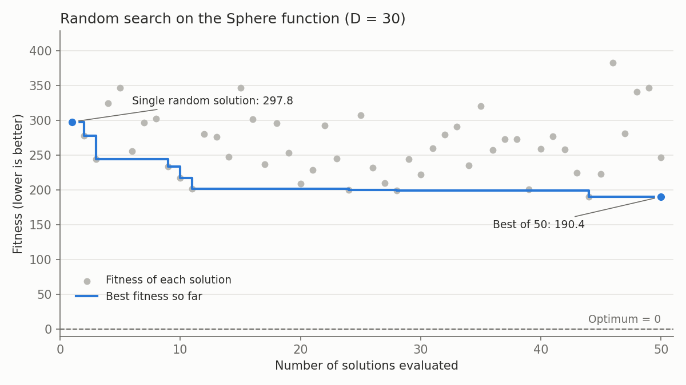

# Toy Problem
## Sphere Function

```math
f(\mathbf{x}) = \sum_{i=1}^{D} x_i^2, \qquad -5.12 \le x_i \le 5.12, \quad D = 30
```

The fitness function is `fitness_function(1, x)`, which sums the squares of all 30 variables. The optimum is $0$ at the origin. Each solution is generated by drawing every $x_i$ uniformly from $[-5.12, 5.12]$, so it always satisfies the constraints.

## Random search



*Fitness of 50 random solutions (grey dots) and the best fitness found so far (blue line). The first point is the single random solution; the last is the best of 50.*

The single random solution scored $297.8$, far from the optimum. Its values are spread across the whole range instead of sitting near $0$, and with 30 dimensions the squared errors add up quickly.

Keeping the best of 50 solutions improved this to $190.4$, but it is still nowhere near $0$. The blue line drops quickly at first and then flattens: after the 11th solution, only small improvements come. In 30 dimensions it is very unlikely that all variables land near $0$ at the same time, so random sampling alone is a poor way to optimise this function.
