# Week 3: Dispersive Flies Optimisation (DFO)
DFO is a swarm algorithm inspired by flies hovering over food. Each fly moves towards the better of its two ring neighbours and the swarm's best fly, which is never updated (elitism). With probability δ, a component is reset randomly, which preserves diversity.

**Setup:** N = 100, 1000 iterations, δ = 0.001, bounds ±5.12, 30 runs. Functions: Sphere (unimodal) and Rastrigin (multimodal). The experiments are in [`week3_dfo_experiments.m`](week3_dfo_experiments.m) (`rng(42)`).

## Results (D = 30)

| Function | Median | Min | Max | Std |
|---|---|---|---|---|
| Sphere | 3.081e-20 | 2.185e-21 | 3.271e-19 | 8.715e-20 |
| Rastrigin | 3.411e-13 | 1.137e-13 | 9.950e-01 | 1.817e-01 |

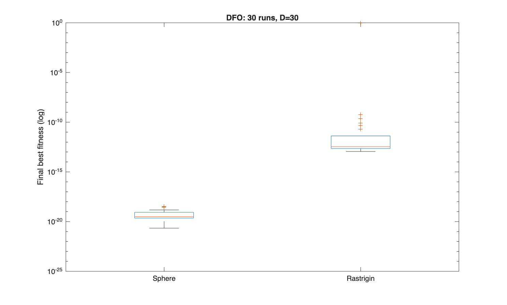

Both functions are solved to near-zero error in the median case. Sphere is very consistent (all runs below 1e-18). On Rastrigin the maximum of 0.995 is an outlier: that run was trapped in a local optimum with one component off by about one unit, which is what raises the Std to 0.18.

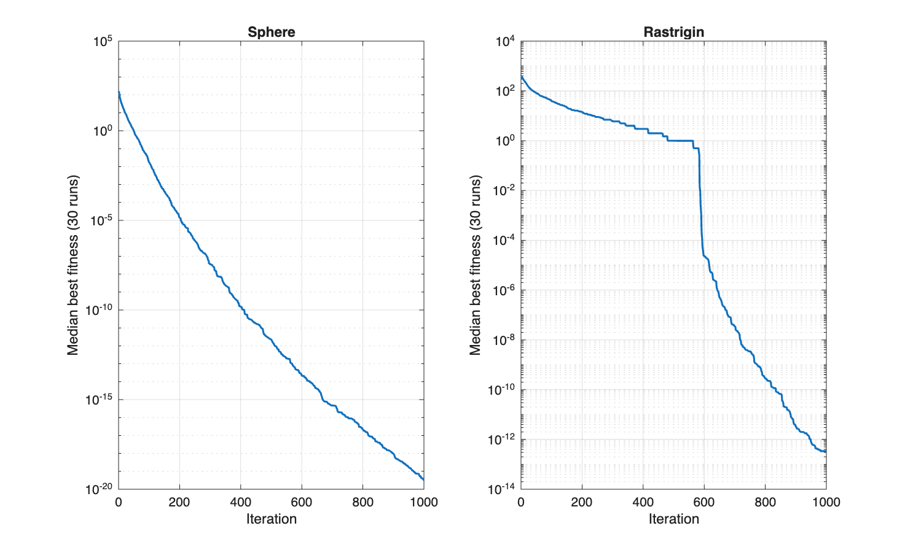

*Median best fitness per iteration over the 30 runs.*

## Dimensionality

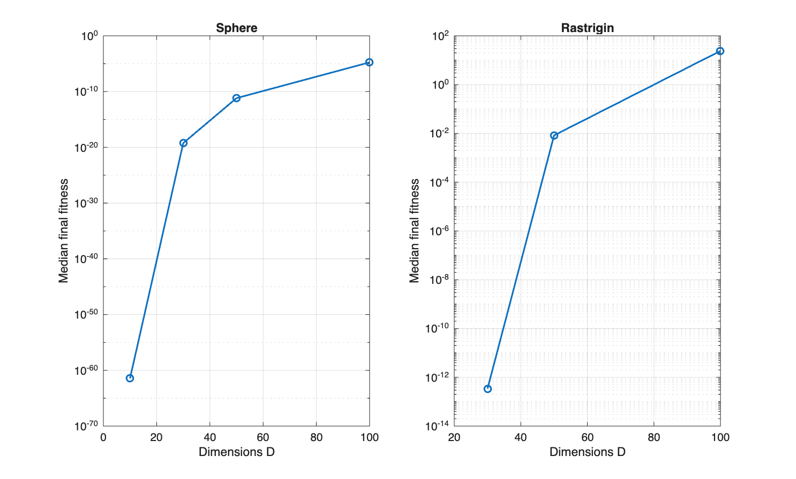

*Median final fitness for D = 2, 10, 30, 50 and 100. Medians of exactly 0 (D = 2 for both functions, D = 10 for Rastrigin) cannot be drawn on a log scale.*

Both functions are solved exactly at D = 2. On Sphere the median worsens from 3.6e-62 (D = 10) to 1.7e-05 (D = 100). Rastrigin degrades much faster, from 0 (D = 10) to 0.008 (D = 50) and 24.06 (D = 100). The search space grows exponentially while swarm size and iterations stay fixed, and Rastrigin's local optima multiply with D.

## Disturbance threshold

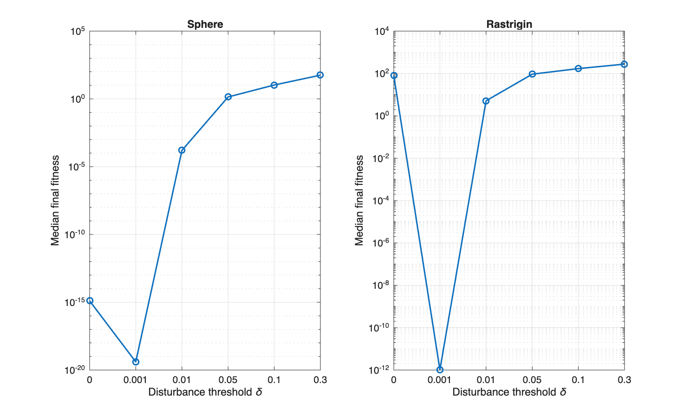

*Median final fitness for δ = 0, 0.001, 0.01, 0.05, 0.1 and 0.3 at D = 30.*

δ = 0.001 was best for both functions (medians 4.0e-20 and 1.0e-12). Without disturbance (δ = 0) results are worse: 1.3e-15 on Sphere, and 79.6 on Rastrigin, where the swarm loses diversity and stagnates. From δ = 0.01 upwards, performance falls steadily, reaching 56.2 (Sphere) and 276.3 (Rastrigin) at δ = 0.3, because too many components are re-randomised for the swarm to converge.

## Conclusions
DFO is accurate on both functions at D = 30 with only two parameters. Accuracy drops in high dimensions, especially on multimodal problems. δ needs tuning: a small non-zero value works best here. Larger swarms or more iterations may help at high D.

---

# Week 4: Dispersive Flies Optimisation (DFO) Continued
DFO applied to simple image analysis. Each fly is a pixel position (row, column), so D = 2 and the bounds are the image edges. The code is in [`week4_dfo_image_analysis.ipynb`](week4_dfo_image_analysis.ipynb). The GIFs below are generated by it (blue = flies, red = swarm's best fly).

## Finding the brightest point in the image
The fitness is the negative pixel brightness, `fitness(x) = -img[row][col]`, so minimising it finds the brightest pixel. Positions are rounded to whole pixels after each update. With N = 50 flies, 100 iterations and δ = 0.001, the swarm converged on the brightest area at (119, 135), with brightness 0.996.

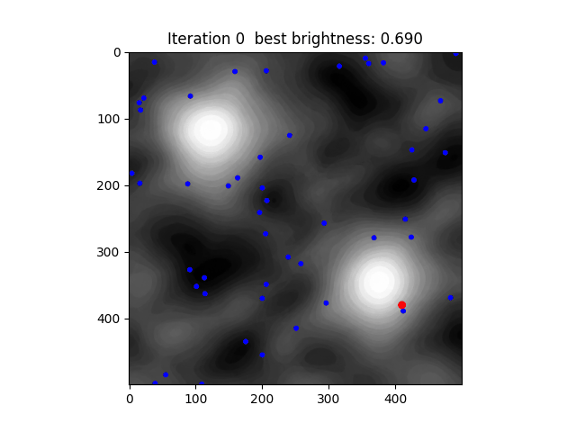

## Finding the brightest point in the image while having motion
The image changes every iteration, so every fly is re-evaluated on the current frame and the best fly is whoever is brightest now. The rest of the swarm follows it. With δ = 0.01 the median tracking error was 4.5 px. Tracking fails if the spot moves further in one frame than the swarm is spread out, and a larger δ helps the swarm pick the spot up again.

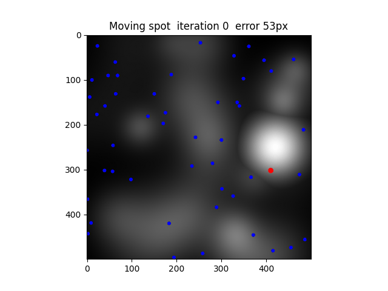

## Finding the brightest point in the image while fading
Spot A fades out while spot B appears elsewhere. By then the swarm has collapsed around A, so no fly is near B when it appears.

### Doing so with no scouts ❌
Only the disturbance (δ = 0.01) puts flies in new places, and it moves just one coordinate at a time. In this run the swarm stays where A was and ends 332 px from B. Over 30 runs, it found B only 18 times.

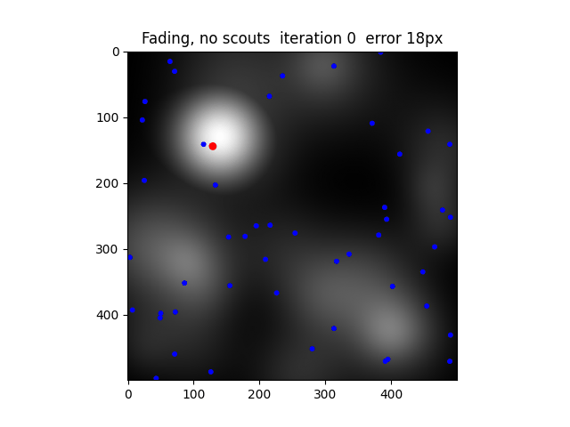

### Doing so with scouts ✅
Each iteration, the 5 worst flies are moved to random positions (scouts), while the other 45 keep converging. As soon as a scout lands on B, it becomes the best fly and the swarm moves there. It found B in 30 out of 30 runs.


## Finding multiple bright points in an image
Standard DFO converges on just one spot, because every fly is pulled towards the single best fly.

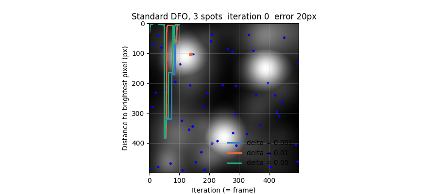

To find all of them, I used sequential search with masking. Run DFO, record the best position, black out a disc around it, and repeat until the best brightness falls below a threshold. This found all three spots: (110, 120), (150, 390) and (380, 250).

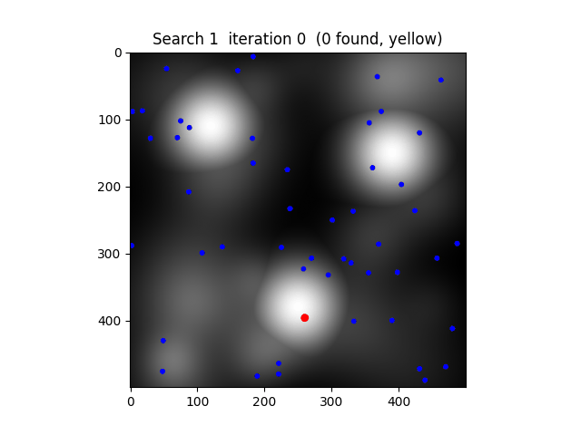

## Finding symmetry in an image
To find a vertical mirror axis, each fly is a single column $c$ (D = 1). The fitness compares a strip of width $w$ on the left of $c$ with the mirrored strip on the right:

```math
f(c) = \frac{1}{Hw} \sum_{r=0}^{H-1} \sum_{k=1}^{w} \left| img[r][c-k] - img[r][c+k] \right|
```

$f(c) = 0$ means perfect symmetry, so DFO minimises it, with $c$ bounded to $[w, W-1-w]$. With w = 80, the swarm found the axis at column 300 with $f = 0$.

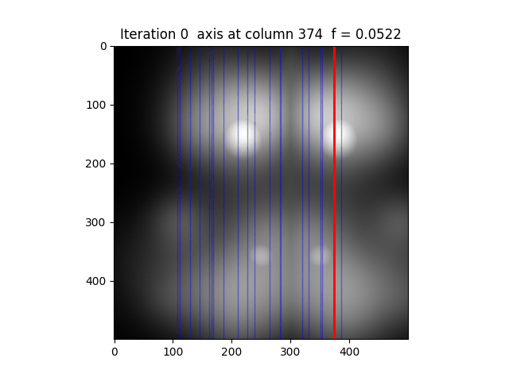

Checking every possible axis confirms that column 300 is the global minimum. The two dips near columns 225 and 375 are local optima that the swarm avoided.

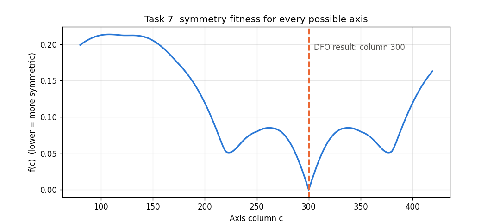
