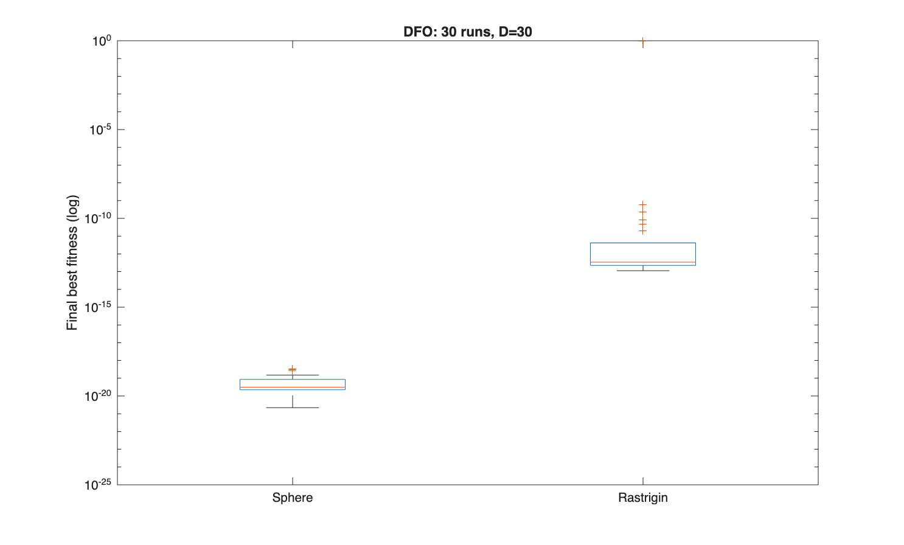
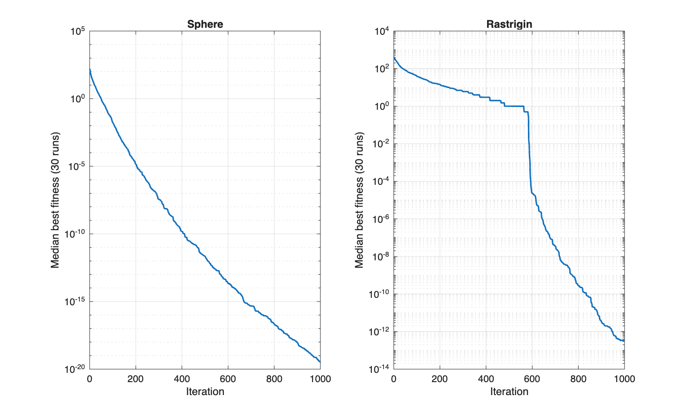
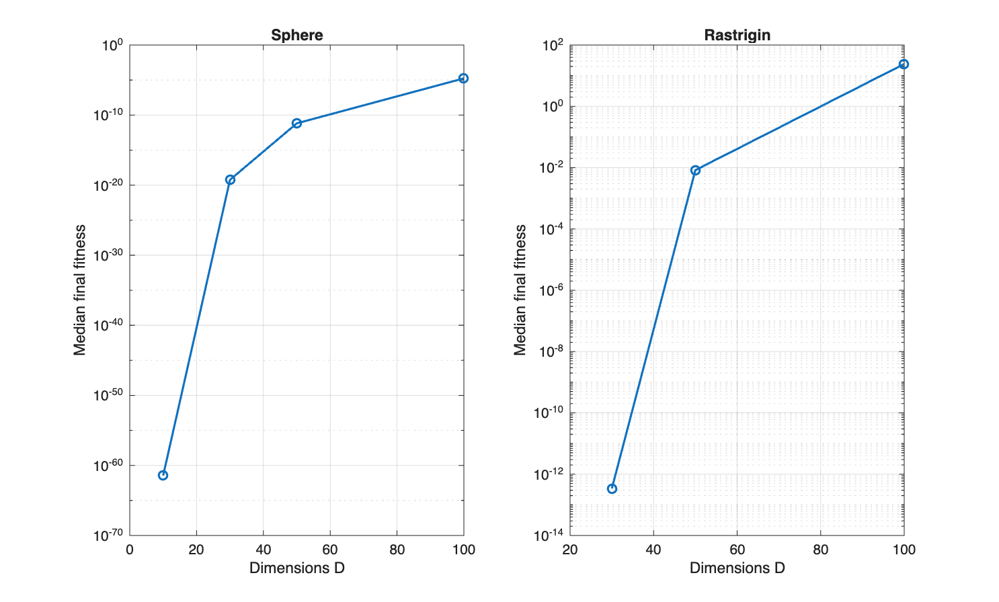
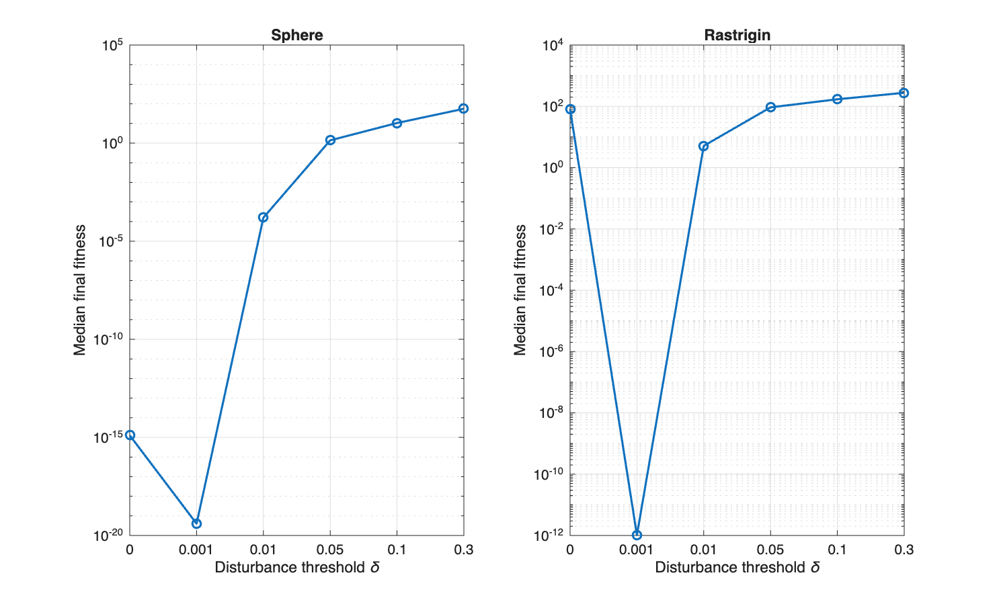

# Dispersive Flies Optimisation (DFO)
DFO is a swarm algorithm inspired by flies hovering over food. Each fly moves towards the better of its two ring neighbours and the swarm's best fly, which is never updated (elitism). With probability δ, a component is reset randomly, which preserves diversity.

**Setup:** N = 100, 1000 iterations, δ = 0.001, bounds ±5.12, 30 runs. Functions: Sphere (unimodal) and Rastrigin (multimodal). The experiments are in [`script.m`](script.m) (`rng(42)`).

## Results (D = 30)

| Function | Median | Min | Max | Std |
|---|---|---|---|---|
| Sphere | 3.081e-20 | 2.185e-21 | 3.271e-19 | 8.715e-20 |
| Rastrigin | 3.411e-13 | 1.137e-13 | 9.950e-01 | 1.817e-01 |

Both functions are solved to near-zero error in the median case. Sphere is very consistent (all runs below 1e-18). On Rastrigin the maximum of 0.995 is an outlier: that run was trapped in a local optimum with one component off by about one unit, which is what raises the Std to 0.18.

*Median best fitness per iteration over the 30 runs.*

## Dimensionality

*Median final fitness for D = 2, 10, 30, 50 and 100. Medians of exactly 0 (D = 2 for both functions, D = 10 for Rastrigin) cannot be drawn on a log scale.*

Both functions are solved exactly at D = 2. On Sphere the median worsens from 3.6e-62 (D = 10) to 1.7e-05 (D = 100). Rastrigin degrades much faster, from 0 (D = 10) to 0.008 (D = 50) and 24.06 (D = 100). The search space grows exponentially while swarm size and iterations stay fixed, and Rastrigin's local optima multiply with D.

## Disturbance threshold

*Median final fitness for δ = 0, 0.001, 0.01, 0.05, 0.1 and 0.3 at D = 30.*

δ = 0.001 was best for both functions (medians 4.0e-20 and 1.0e-12). Without disturbance (δ = 0) results are worse: 1.3e-15 on Sphere, and 79.6 on Rastrigin, where the swarm loses diversity and stagnates. From δ = 0.01 upwards, performance falls steadily, reaching 56.2 (Sphere) and 276.3 (Rastrigin) at δ = 0.3, because too many components are re-randomised for the swarm to converge.

## Conclusions
DFO is accurate on both functions at D = 30 with only two parameters. Accuracy drops in high dimensions, especially on multimodal problems. δ needs tuning: a small non-zero value works best here. Larger swarms or more iterations may help at high D.
