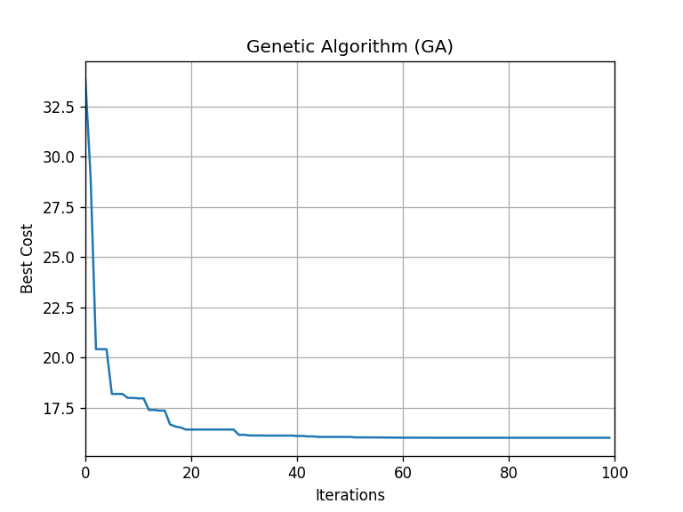
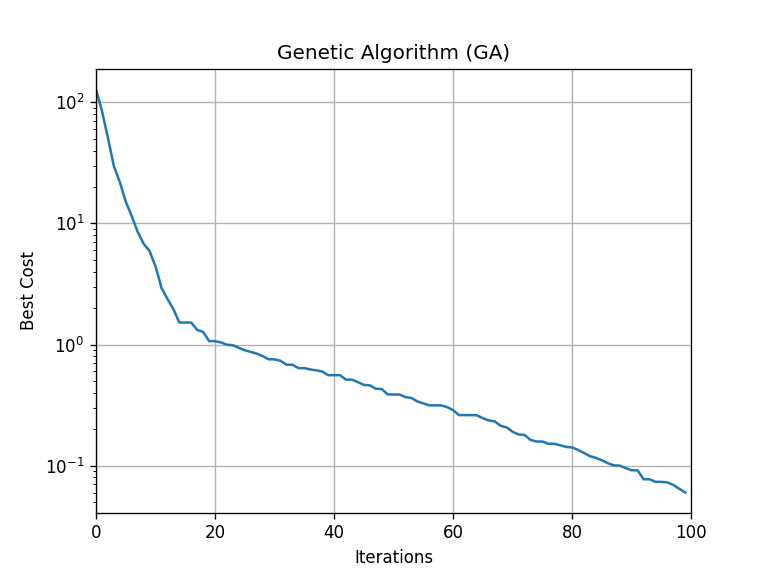
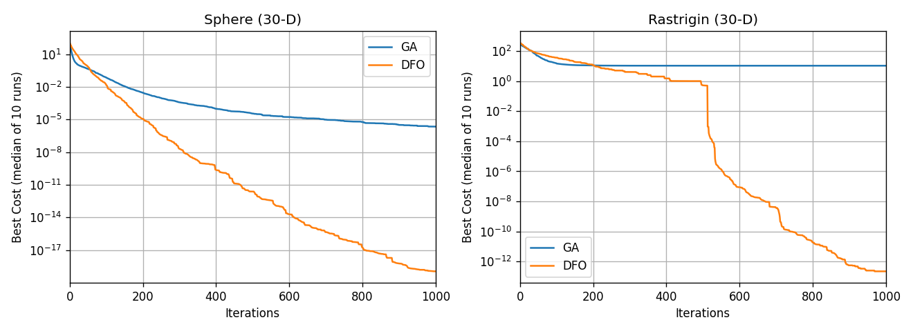

# Genetic Algorithm (GA)
Initially, the fitness function of the given code is a Sphere:

```math
f_{\text{Sphere}}(\mathbf{x}) = \sum_{i=1}^{D} x_i^2
```

The original 5-D run ([`app_original.py`](app_original.py)) converges to about 16.00002, not 0. The 5th variable is limited to [4, 10], so the smallest possible cost is 4² = 16. That shows the GA respects the variable bounds.



## 30 dimensions
I changed [`app.py`](app.py) to `nvar = 30`, `npop = 100` and bounds of [-5.12, 5.12] for every variable. I also switched the plot to a log scale. After 100 iterations the best cost was about 0.06 in the run shown (between 0.02 and 0.12 over 10 seeds).



## GA vs DFO
GA vs DFO, 1000 iterations, 30-D ([`compare.py`](compare.py), with DFO in [`dfo.py`](dfo.py)). Both algorithms used 100 individuals, which means 100 fitness evaluations per iteration each, so the budget was equal. I ran each one 10 times with fixed seeds, on Sphere and on Rastrigin:

```math
f_{\text{Rastrigin}}(\mathbf{x}) = 10D + \sum_{i=1}^{D} \left[ x_i^2 - 10\cos(2\pi x_i) \right]
```

Final best cost:

| Function | Alg | Mean | Median | Min | Max | Std |
|---|---|---|---|---|---|---|
| Sphere | GA | 2.5e-06 | 2.2e-06 | 1.1e-06 | 4.1e-06 | 9.7e-07 |
| Sphere | DFO | 4.5e-19 | 1.1e-19 | 3.6e-21 | 3.6e-18 | 1.0e-18 |
| Rastrigin | GA | 10.95 | 10.45 | 6.97 | 14.92 | 2.18 |
| Rastrigin | DFO | 2.1e-11 | 2.3e-13 | 1.1e-13 | 1.8e-10 | 5.3e-11 |



What the results show:

- **Sphere:** the GA drops faster for the first ~50 iterations, then slows down a lot. DFO keeps improving and finishes about 13 orders of magnitude lower.
- **Rastrigin:** the GA gets stuck in a local minimum (cost about 10) by around iteration 150 and never escapes. Its mutation is very weak (`mu = 0.01`, `sigma = 0.1`), and keeping only the best 100 after each generation makes the population lose diversity quickly. DFO's disturbance (`delta = 0.001`) randomly resets single coordinates, which lets it jump out of local minima. You can see this as the sudden drop around iteration 500 in the plot.
- **Caveat:** both test functions have their optimum at the origin, in the centre of the search space. DFO's update rule tends to pull flies towards the centre, so it may be favoured here. A shifted version of the functions would be a fairer test.
